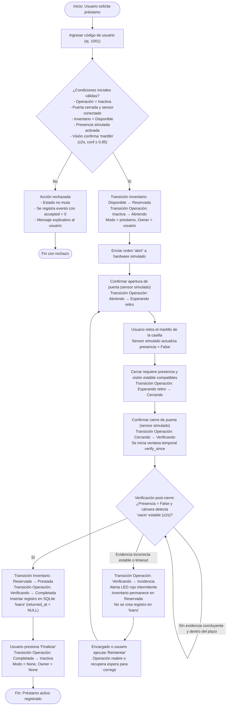
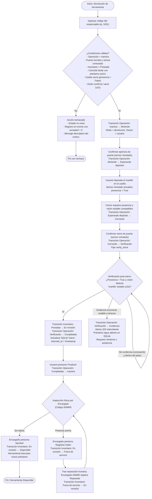

# Avance 4 — VII. Análisis del problema

> **Documento de sustentación técnica y académica.**  
> Este análisis delimita el contexto del problema, define los actores del sistema, formaliza los requerimientos funcionales y no funcionales verificables, y documenta los procesos operativos y casos de uso del **Sistema de préstamo de herramientas basado en autómatas finitos y verificación visual**.  
> El contenido está basado en el código fuente del proyecto (`app/engine.py`, `app/automata.py`, `app/web.py`, `app/camera.py`), en las guías oficiales del curso ([guía Avance 4](https://avance4proyectoaula.netlify.app/)) y en los acuerdos de alcance consignados en [`BASE_PROYECTO.md`](avances/BASE_PROYECTO.md).

---

## 1. Situación actual y descripción del problema

### 1.1 Contexto propuesto y proceso por confirmar

El caso de aplicación propuesto es un laboratorio académico que presta herramientas menores. La necesidad formulada es conocer quién solicita una herramienta, si está disponible y si su devolución fue registrada y revisada. La institución y su procedimiento concreto todavía no han sido documentados mediante trabajo de campo.

Como escenario de análisis se plantea la secuencia: solicitud al encargado, consulta de disponibilidad, entrega y registro del responsable, devolución, inspección y actualización de disponibilidad. Es una hipótesis de proceso que el equipo debe contrastar con la ficha de observación y la entrevista de [Instrumentos de evidencia](avances/INSTRUMENTOS_EVIDENCIA.md). No se afirma que existan cuadernos, pérdidas, demoras o prácticas específicas en una institución sin evidencia.

### 1.2 Necesidades y riesgos que se estudiarán

1. Evitar que una misma unidad tenga dos préstamos activos registrados.
2. Conservar responsable, tiempos y eventos para reconstruir el ciclo de préstamo.
3. Comprobar las condiciones de retiro y devolución en una escena controlada.
4. Exigir revisión humana antes de reincorporar una herramienta devuelta.

Estas necesidades justifican las funciones del prototipo. La frecuencia y las consecuencias reales de los problemas se determinarán con observación autorizada; el software y las pruebas automatizadas no sustituyen esa evidencia.

### 1.3 Delimitación del alcance tecnológico del prototipo
Para estudiar estas necesidades, el proyecto define un prototipo controlado con las siguientes características técnicas reales:
- **Unidad de análisis:** Control estricto del ciclo de préstamo y devolución de **una unidad de martillo** (con capacidad de clasificación para diferenciarlo de destornilladores, alicates, casilla vacía u otros objetos).
- **Mecanismo de decisión determinista:** Control centralizado mediante dos autómatas finitos deterministas coordinados: ciclo de inventario (5 estados) y control de operación física (8 estados).
- **Cámara y visión artificial:** Cámara web estándar o teléfono móvil vía DroidCam para captura de imágenes en vivo; previsualización, gestión de dataset y modelo de clasificación convolucional YOLO11n-cls pendiente de entrenamiento con datos propios.
- **Hardware simulado:** Las señales de apertura y cierre de la puerta y la presencia de objetos se representan mediante un adaptador de software (`SimulatedHardware` en `app/hardware.py`). Esto permite estudiar la lógica antes de integrar un mecanismo físico, que todavía no existe en el prototipo.
- **Simulador didáctico independiente:** Módulo autónomo en `simulator/` que reproduce el comportamiento de los autómatas con escena 3D y escenarios automáticos en memoria, sin interferir con la base de datos real del prototipo.

---

## 2. Identificación de actores del sistema

Los actores representan roles que interactúan con el sistema o forman parte del flujo de control. Se distinguen claramente los actores humanos de los subsistemas y adaptadores tecnológicos.

| Actor | Categoría | Responsabilidad en el proceso | Interacción e información intercambiada | Necesidad o expectativa |
|---|---|---|---|---|
| **Usuario / Estudiante** | Humano | Solicitar el préstamo, retirar el martillo, devolverlo tras su uso y solicitar el cierre de la casilla. | Ingresa su código de identificación demostrativo (`1001`, `1002`). Consulta en pantalla la disponibilidad de la herramienta y recibe instrucciones de paso. | Requiere un trámite ágil, conocer de inmediato si su préstamo fue aceptado y consultar que el préstamo y la devolución queden registrados. |
| **Encargado del Laboratorio** | Humano (Supervisor) | Realizar la inspección visual/física de las herramientas devueltas, registrar su aprobación tras la revisión, marcar daños o reportar reparaciones concluidas. | Ingresa su código con privilegios administrativos (`ADMIN`). Ejecuta las acciones de aprobación (`aprobar`), reporte de daño (`danada`) o término de reparación (`reparada`). | Requiere supervisar el inventario en tiempo real, disponer de un historial persistente de movimientos y asegurar que ninguna herramienta dañada se preste de nuevo. |
| **Operador Local** | Humano (Técnico) | Configurar la estación de trabajo, inicializar el servidor Flask/Waitress, configurar la cámara web y gestionar la captura de imágenes. | Interactúa con la consola y con el Centro de Control local en `http://127.0.0.1:8000/control`. Inicia y detiene la cámara, define la región de interés (ROI) y captura imágenes para el dataset. | Necesita herramientas de diagnóstico, visualización de errores de cámara y confirmación del estado de los sensores. |
| **Subsistema de Visión Artificial** | Técnico (Dispositivo / Algoritmo) | Capturar cuadros de video de la casilla, recortar la región de interés y clasificar el objeto observado (`martillo`, `destornillador`, `alicate`, `vacio`, `otros`). | Proporciona observaciones continuas al motor (`observe(label, confidence, frame_id, timestamp)`). Emite eventos de reconocimiento estable cuando se cumplen los criterios temporales. | Requiere iluminación controlada, encuadre adecuado y estabilidad temporal en los cuadros analizados. |
| **Adaptador de puerta y presencia** | Componente técnico simulado | Representar el estado de la puerta y la presencia de objetos. | El operador cambia esas señales simuladas durante la prueba; el adaptador no lee un sensor físico. | Permite probar reglas antes de instalar y evaluar hardware real. |

> [!NOTE]
> **Identidades demostrativas:**  
> Los códigos de usuario preconfigurados (`1001` - Estudiante 1, `1002` - Estudiante 2, `ADMIN` - Encargado) han sido implementados en SQLite para permitir la pruebas de los flujos de autorización y rechazo. No constituyen un sistema de identidad biométrica o institucional definitivo para producción.

---

## 3. Requerimientos del sistema

### 3.1 Requerimientos Funcionales (RF)

Los requerimientos funcionales expresan de forma no ambigua las operaciones y servicios que el sistema ejecuta de manera verificable.

| ID | Requerimiento Funcional | Actor relacionado | Criterio de verificación observable | Trazabilidad en código |
|---|---|---|---|---|
| **RF01** | **Visualización de estados y disponibilidad:** El sistema deberá consultar y presentar en tiempo real el estado administrativo del inventario (`Disponible`, `Reservada`, `Prestada`, `En revisión`, `Fuera de servicio`) y el estado de la operación física (`Inactiva`, `Abriendo`, `Esperando retiro`, `Esperando depósito`, `Cerrando`, `Verificando`, `Completada`, `Incidencia`). | Usuario, Encargado, Operador | La respuesta JSON de `/api/estado` entrega el objeto serializado de ambos autómatas. El portal web actualiza dinámicamente las etiquetas de estado y el color del indicador LED virtual. | `app/engine.py` (`Engine.snapshot`), `templates/portal.html` |
| **RF02** | **Solicitud y reserva verificada de préstamo:** El sistema deberá permitir iniciar una solicitud cuando el inventario esté en `Disponible`, la operación en `Inactiva`, la puerta simulada cerrada y la señal de presencia simulada activa. La cámara deberá aportar evidencia estable del martillo según la configuración. | Usuario, sistema | Si se cumplen las condiciones, el inventario pasa a `Reservada` y la operación a `Abriendo`; si no, la acción se rechaza y conserva los estados. | `app/engine.py` (`_apply`, acción `solicitar`) |
| **RF03** | **Retiro físico y registro de préstamo:** El sistema deberá registrar el retiro exitoso únicamente tras comprobar la secuencia: apertura de puerta, retiro del objeto (presencia = False), solicitud de cierre, confirmación de sensor de puerta cerrada y verificación visual post-cierre de casilla vacía durante al menos 2,0 segundos. | Usuario, Visión, Sensores | El sistema inserta un registro en la tabla `loans` con `user_code`, `tool='martillo'`, fecha UTC y `returned_at = NULL`. El inventario cambia a `Prestada` y la operación a `Completada`. | `app/engine.py` (método `_evaluate`), `app/automata.py` |
| **RF04** | **Solicitud de devolución controlada:** El sistema deberá permitir iniciar una devolución solo si el inventario está en `Prestada`, el código ingresado corresponde exactamente al usuario que tiene el préstamo activo, la puerta está cerrada y la casilla se encuentra vacía y comprobada visualmente. | Usuario, Visión | Si el usuario no es el responsable registrado en `loans`, la acción es rechazada. Si es válida, la operación transiciona a `Abriendo` en modo `devolucion`. | `app/engine.py` (método `_apply` en `action == "devolver"`) |
| **RF05** | **Verificación de depósito y tránsito a revisión:** El sistema deberá exigir el depósito del martillo, cierre de puerta y comprobación visual post-cierre de presencia del martillo estable por 2,0 segundos. Ante confirmación válida, actualizará el préstamo activo con la fecha de devolución y enviará la herramienta al estado `En revisión`. | Usuario, Visión, Sensores | Se actualiza `returned_at` en `loans`, el inventario transiciona de `Prestada` a `En revisión` y la operación a `Completada`. La herramienta NO queda disponible inmediatamente para otro usuario. | `app/engine.py` (método `_evaluate`) |
| **RF06** | **Inspección técnica y decisión del encargado:** El sistema deberá permitir exclusivamente al actor Encargado (código `ADMIN`), con la operación `Inactiva`, ejecutar una de tres acciones técnicas: `aprobar` (transiciona a `Disponible` tras comprobar puerta cerrada, presencia y martillo), `danada` (transiciona a `Fuera de servicio`) o `reparada` (transiciona de `Fuera de servicio` a `En revisión`). | Encargado | Intento de ejecución con código de estudiante es rechazado con error 409/Rejected. La aprobación exitosa restablece la herramienta para nuevos préstamos. | `app/engine.py` (método `_apply` en `action in ("aprobar", "danada", "reparada")`) |
| **RF07** | **Rechazo determinista y registro de eventos inválidos:** El sistema deberá rechazar cualquier evento o acción no permitido por los autómatas en el estado corriente, garantizando que el estado no mute y almacenando el intento en la tabla de auditoría con `accepted = 0`. | Sistema | Ante un intento fuera de regla (ej. solicitar retiro cuando ya está prestada), la base de datos registra el evento en `events` con `accepted = 0` y la respuesta HTTP entrega `ok: false`. | `app/engine.py` (método `dispatch`) |
| **RF08** | **Historial persistente y persistencia relacional:** El sistema deberá registrar de forma atómica y secuencial cada evento, transición, rechazo o cambio de sensor en la tabla `events` de SQLite, permitiendo la descarga del historial completo en formato CSV estructurado. | Sistema, Encargado | La ruta `GET /api/historial.csv` descarga el log con columnas: `seq`, `time`, `machine`, `event`, `previous`, `current`, `source`, `accepted`, `message`. | `app/web.py` (`history`), `app/engine.py` (`_event`) |
| **RF09** | **Monitor de solo lectura sincronizado:** El sistema deberá ofrecer una vista web independiente (`/monitor`) accesible desde dispositivos móviles o tablets que consulte el estado periódicamente sin exponer ningún control de mutación ni token de autorización. | Encargado, Observador | La vista `/monitor` no incluye el encabezado `X-Control-Token` ni botones de acción de control. Solo ejecuta `GET /api/estado` cada 500 ms y renderiza los diagramas SVG interactivos. | `app/web.py` (`monitor`), `templates/portal.html` |
| **RF10** | **Conexión, incidencias y recuperación:** La interfaz deberá avisar cuando la información esté desactualizada por desconexión.  Durante una operación pendiente, el sistema deberá transicionar al estado `Incidencia` ante fallos de hardware, desconexión de sensores, tiempo de verificación agotado (>12 s) u objetos incorrectos post-cierre, manteniendo la operación pendiente hasta su recuperación y habilitando la acción `reintentar`. | Sistema, Encargado, Usuario | Ante incidencia, el estado visible de la operación cambia a `Incidencia`. El inventario permanece protegido en su estado previo hasta que el operador resuelva el fallo y reintente la acción. | `app/engine.py` (`_incident`, `_evaluate`, `reintentar`) |

---

### 3.2 Requerimientos No Funcionales (RNF)

Los requerimientos no funcionales definen los atributos de calidad, rendimiento, seguridad y confiabilidad del prototipo.

| ID | Atributo de Calidad | Requerimiento No Funcional | Criterio de verificación cuantitativo / verificable |
|---|---|---|---|
| **RNF01** | **Determinismo** | Las transiciones definidas tendrán a lo sumo un destino por estado y evento. Los eventos no definidos se rechazarán en el controlador. | La definición compartida está en `app/automata.py`; `tests/test_engine.py::test_formal_recognizer_and_complete_transition_definition` comprueba la tabla de transiciones. |
| **RNF02** | **Integridad de préstamos** | La base de datos no permitirá más de un préstamo activo de la misma herramienta. | Índice único parcial definido en `app/engine.py`: `one_active_loan` para filas con `returned_at IS NULL`. |
| **RNF03** | **Control local de escritura** | Las peticiones que cambian datos deberán cumplir las condiciones locales de control configuradas por la aplicación. | `app/web.py` comprueba dirección loopback, token, origen si se envía y `Sec-Fetch-Site`. El monitor no recibe el token ni contiene acciones de escritura. Esto no equivale a una auditoría integral de seguridad. |
| **RNF04** | **Consistencia y persistencia atómica** | Todas las mutaciones de estado, registros de préstamos y eventos de auditoría deben ejecutarse bajo transacciones atómicas SQLite en modo WAL (*Write-Ahead Logging*). | Transacciones atómicas de contexto `with self.db:`. Si ocurre una excepción en cualquier paso, la base de datos ejecuta rollback íntegro y el estado en memoria se restaura a la copia de seguridad previa (`deepcopy`). |
| **RNF05** | **Monitor de lectura y actualización** | El monitor debe consultar periódicamente el estado y avisar cuando pierde conexión. | La interfaz consulta `/api/estado` cada 500 ms y muestra el estado de conexión. La frecuencia de consulta no establece una latencia máxima de red. |
| **RNF06** | **Evidencia visual y límites visibles** | La evidencia de visión artificial requerida para autorizar o verificar una operación debe ser reciente y estable, descartando detecciones efímeras o desactualizadas. La interfaz debe indicar hardware simulado y modelo pendiente cuando corresponda. | Parámetros configurables en `config.json`: caducidad de observación `fresh_seconds = 1.5 s`, ventana mínima de estabilidad temporal `stable_seconds = 2.0 s`, mínimo de 5 cuadros consecutivos con etiqueta idéntica y umbral de confianza mínimo de 0,85. |
| **RNF07** | **Autonomía operativa local** | El prototipo debe funcionar de manera completamente autónoma en red de área local (LAN) o en un equipo aislado, sin requerir conexión a internet para su operación rutinaria. | Todas las dependencias (Flask, Waitress, OpenCV, PyTorch/YOLO) se ejecutan localmente. Los archivos estáticos (CSS, JS, SVG) se sirven desde el directorio local `static/` sin librerías CDN externas. |

---

## 4. Procesos y casos de uso

### 4.1 Proceso detallado de préstamo de herramienta

```text
[Inicio]
   │
   ▼
1. Usuario ingresa código demostrativo (1001 o 1002) en el Centro de Control.
   │
   ▼
2. Motor verifica precondiciones:
   ¿Operación == "Inactiva"?
   ¿Puerta cerrada y sensor de presencia conectado?
   ¿Inventario == "Disponible"?
   ¿Presencia == True?
   ¿Visión artificial detecta "martillo" estable (≥ 2 s, conf ≥ 0.85)?
   ├── [No] ──► Rechazo inmediato: no muta estado, evento guardado con accepted=0, mensaje de error. (FIN)
   │
   └── [Sí] ──► Aceptación:
                - Inventario pasa a "Reservada".
                - Operación pasa a "Abriendo" (modo="prestamo", owner=código).
                - Se envía orden de apertura al adaptador de hardware.
   │
   ▼
3. El operador cambia la señal simulada de puerta a abierta:
   - Operación pasa a "Esperando retiro".
   │
   ▼
4. El usuario retira el martillo de la casilla; el operador cambia la señal de presencia simulada a `False`.
   │
   ▼
5. Usuario presiona botón "Cerrar":
   - Motor verifica que la casilla esté vacía (presencia == False y visión == "vacio").
   - Operación pasa a "Cerrando" y se envía orden física de cierre.
   │
   ▼
6. Sensor confirma puerta cerrada:
   - Operación pasa a "Verificando".
   - Se fija la marca temporal de verificación `verify_since`.
   │
   ▼
7. Verificación visual post-cierre:
   - El sistema analiza nuevos cuadros de cámara capturados POSTERIORES al cierre.
   ¿Hay evidencia nueva y estable de "vacio" y presencia == False? Si falta evidencia concluyente, permanece Verificando hasta disponer de ella o agotar el tiempo configurado (12 s).
   ├── [Evidencia estable incorrecta, contradicción o timeout] ──► Operación pasa a "Incidencia". Préstamo NO se registra. Requiere "Reintentar".
   │
   └── [Sí] ────────────► Éxito:
                          - Se inserta registro en tabla 'loans' (user_code, tool='martillo', borrowed_at).
                          - Inventario pasa a "Prestada".
                          - Operación pasa a "Completada".
   │
   ▼
8. Usuario presiona "Finalizar":
   - Operación retorna a "Inactiva" (modo=None, owner=None).
[Fin: Préstamo Activo]
```

#### Diagrama de flujo del proceso de préstamo
El flujo completo se encuentra disponible en el archivo [`docs/avances/diagramas/proceso_prestamo.mmd`](avances/diagramas/proceso_prestamo.mmd) y se representa a continuación:



---

### 4.2 Proceso detallado de devolución y revisión técnica

```text
[Inicio]
   │
   ▼
1. Usuario responsable ingresa su código demostrativo y presiona "Iniciar devolución".
   │
   ▼
2. Motor valida precondiciones de devolución:
   ¿Inventario == "Prestada"?
   ¿Operación == "Inactiva"?
   ¿Existe préstamo activo en tabla 'loans' asociado a este 'user_code'?
   ¿Puerta cerrada, casilla vacía (presencia == False) y visión == "vacio"?
   ├── [No] ──► Rechazo de acción: mensaje de advertencia, estado intacto. (FIN)
   │
   └── [Sí] ──► Aceptación:
                - Operación pasa a "Abriendo" (modo="devolucion", owner=usuario).
                - Se envía orden física de apertura.
   │
   ▼
3. Sensor simulado confirma apertura:
   - Operación pasa a "Esperando depósito".
   │
   ▼
4. Usuario deposita el martillo en la casilla en la casilla:
   - Sensor de presencia conmuta a True.
   │
   ▼
5. Usuario presiona "Cerrar":
   - Motor valida que la presencia sea True y visión previa indique "martillo".
   - Operación pasa a "Cerrando" y se envía orden de cierre.
   │
   ▼
6. Sensor confirma puerta cerrada:
   - Operación pasa a "Verificando" (se fija `verify_since`).
   │
   ▼
7. Verificación visual post-cierre:
   - El sistema evalúa imágenes recientes posteriores al cierre.
   ¿Visión confirma "martillo" estable durante 2 s y presencia == True?
   ├── [No / Objeto ajeno / Timeout] ──► Operación pasa a "Incidencia". Préstamo sigue abierto.
   │
   └── [Sí] ──────────────────────────► Éxito de devolución:
                                        - Se actualiza tabla 'loans' con fecha returned_at = utc().
                                        - Inventario pasa de "Prestada" a "En revisión".
                                        - Operación pasa a "Completada".
   │
   ▼
8. Usuario presiona "Finalizar":
   - Operación retorna a "Inactiva".
   │
   ▼
9. INSPECCIÓN TÉCNICA HUMANA (Encargado con código 'ADMIN'):
   - El encargado examina la herramienta físicamente.
   - Opción A (Sin daños): Encargado ejecuta "Aprobar"
       └──► Inventario pasa de "En revisión" a "Disponible" (lista para nuevo préstamo).
   - Opción B (Presenta avería): Encargado ejecuta "Registrar Daño"
       └──► Inventario pasa de "En revisión" a "Fuera de servicio".
       └──► Tras mantenimiento en taller, encargado ejecuta "Reparada"
              └──► Inventario pasa a "En revisión" (exige nueva aprobación).
[Fin: Ciclo Completo Concluido]
```

#### Diagrama de flujo del proceso de devolución y revisión
El diagrama completo se almacena en [`docs/avances/diagramas/proceso_devolucion.mmd`](avances/diagramas/proceso_devolucion.mmd) y se muestra a continuación:



---

### 4.3 Especificación de casos de uso del sistema

#### Tabla general de casos de uso

| Identificador | Caso de Uso | Actores Principales | Tipo / Propósito | Requerimiento asociado |
|---|---|---|---|---|
| **UC01** | Solicitar Préstamo de Martillo | Estudiante / Usuario | Operativo / Transaccional | RF01, RF02, RNF01, RNF06 |
| **UC02** | Confirmar Apertura y Retiro Físico | Estudiante, Sensores | Control Físico / Transición | RF02, RF03 |
| **UC03** | Cancelar Reserva de Préstamo | Estudiante / Usuario | Excepción / Control | RF02, RF07 |
| **UC04** | Iniciar Devolución de Herramienta | Estudiante / Usuario | Operativo / Verificación | RF04, RNF02 |
| **UC05** | Confirmar Depósito y Cierre | Estudiante, Visión, Sensores | Control Físico / Persistencia | RF04, RF05, RNF04 |
| **UC06** | Inspeccionar y Aprobar Devolución | Encargado del Laboratorio | Supervisión Técnica / Calidad | RF06 |
| **UC07** | Registrar Daño de Herramienta | Encargado del Laboratorio | Mantenimiento / Seguridad | RF06 |
| **UC08** | Registrar Reparación Concluida | Encargado del Laboratorio | Mantenimiento Técnico | RF06 |
| **UC09** | Consultar Monitor y Trazabilidad | Encargado, Observador | Consulta / Auditoría | RF08, RF09, RNF05 |
| **UC10** | Recuperar Operación ante Incidencia | Encargado, Operador, Usuario | Manejo de Contingencias | RF07, RF10 |
| **UC11** | Operar Cámara y Capturar Dataset | Operador Local | Configuración / Aprendizaje | RNF06, RNF07 |

---

#### Especificación formal de casos de uso críticos

##### UC01: Solicitar Préstamo de Martillo
- **Actores:** Estudiante / Usuario (principal), Subsistema de Visión Artificial (secundario).
- **Precondiciones:**
  1. El sistema se encuentra en ejecución con servidor web activo.
  2. El inventario está en estado `Disponible`.
  3. La operación está en estado `Inactiva`.
  4. La puerta está cerrada (`door_closed = True`) y el sensor está conectado (`hardware_connected = True`).
  5. El sensor de presencia detecta ocupación física (`presence = True`).
  6. La cámara web está conectada y reporta observaciones clasificadas como `martillo` con confianza ≥ 0,85 durante al menos 2,0 segundos continuos.
- **Flujo principal:**
  1. El estudiante ingresa su código demostrativo (`1001` o `1002`) en el Centro de Control local.
  2. El estudiante pulsa el botón «Solicitar martillo».
  3. El cliente genera un UUID de acción (`action_id`) y envía una petición HTTP `POST /api/acciones` con carga JSON `{action: "solicitar", payload: {code: "1001"}}` y cabecera `X-Control-Token`.
  4. El motor verifica la validez del token y las precondiciones bajo un bloqueo de exclusión mutua (`RLock`).
  5. El motor transiciona el autómata de inventario a `Reservada` y el de operación a `Abriendo`.
  6. El motor fija `mode = "prestamo"` y `owner = "1001"`.
  7. El motor envía la orden `abrir` al adaptador de hardware.
  8. El sistema persiste el nuevo estado en SQLite (`state`), registra el evento en `events` con `accepted = 1` y almacena la respuesta en `requests` para garantizar idempotencia.
  9. El cliente recibe confirmación HTTP 200 y muestra en interfaz la orden de apertura.
- **Flujos alternativos / Excepciones:**
  - *2a. Código no registrado:* El sistema rechaza la petición con mensaje «Código de usuario no registrado», registra el evento rechazado (`accepted = 0`) y retorna HTTP 409. El estado no muta.
  - *2b. Herramienta no disponible o prestada:* El sistema rechaza con mensaje «La herramienta no está disponible».
  - *2c. Cámara sin observaciones estables de martillo:* El sistema rechaza con mensaje «Falta evidencia reciente y estable de «martillo» durante dos segundos».
- **Postcondiciones:** El martillo queda reservado exclusivamente para el usuario; la casilla inicia su secuencia de apertura y ningún otro usuario puede solicitar la herramienta.

---

##### UC05: Confirmar Depósito, Cierre y Verificación
- **Actores:** Estudiante (principal), Subsistema de Visión Artificial (secundario), Adaptador de Sensores (secundario).
- **Precondiciones:**
  1. La operación está en estado `Esperando depósito` con `mode = "devolucion"`.
  2. El usuario depositó el martillo dentro del compartimiento (`presence = True`).
- **Flujo principal:**
  1. El usuario presiona «Cerrar» en la pantalla de control.
  2. El motor comprueba que la presencia sea `True` y que la cámara observe `martillo`.
  3. La operación transiciona a `Cerrando` y se emite la orden `cerrar`.
  4. El sensor simulado emite la confirmación de compuerta cerrada (`action: "puerta_cerrada"`).
  5. La operación transiciona a `Verificando` y se captura la marca de tiempo `verify_since = clock()`.
  6. El vigilante en segundo plano (`verification-watchdog`) y las observaciones entrantes de cámara evalúan la evidencia posterior al cierre.
  7. La cámara entrega observaciones continuas de `martillo` con confianza ≥ 0,85 durante 2,0 segundos con marcas temporales mayores a `verify_since`.
  8. El motor valida que `presence == True` y que la imagen coincida con el martillo.
  9. El motor actualiza la tabla `loans` fijando `returned_at` con la marca ISO UTC actual para el préstamo activo del usuario.
  10. El inventario transiciona de `Prestada` a `En revisión`.
  11. La operación transiciona de `Verificando` a `Completada`.
  12. El usuario presiona «Finalizar», devolviendo la operación a `Inactiva`.
- **Flujos alternativos / Excepciones:**
  - *6a. Depósito de objeto ajeno (destornillador, alicate o falso objeto):* La cámara detecta una clase distinta de `martillo`. El motor transiciona la operación a `Incidencia`, enciende el indicador de alerta y mantiene el préstamo activo en `loans`.
  - *6b. Tiempo agotado de verificación (>12 s sin imagen concluyente):* El motor declara `Incidencia` por tiempo agotado. El préstamo continúa activo y el encargado/usuario debe pulsar «Reintentar».
- **Postcondiciones:** El préstamo queda formalmente cerrado en base de datos; la herramienta pasa a estado `En revisión` y queda bloqueada hasta la inspección técnica humana del encargado.

---

##### UC06: Inspeccionar y Aprobar Devolución
- **Actores:** Encargado del Laboratorio (principal, código `ADMIN`).
- **Precondiciones:**
  1. El inventario está en estado `En revisión`.
  2. La operación está en estado `Inactiva`.
  3. La compuerta se encuentra cerrada con presencia y martillo comprobados.
- **Flujo principal:**
  1. El encargado inspecciona físicamente el estado del martillo (cabeza, cuña, mango y superficie de impacto).
  2. Al verificar que no presenta fisuras ni deformaciones, el encargado ingresa su código `ADMIN` en la sección de revisión técnica del panel.
  3. El encargado pulsa «Aprobar».
  4. El motor verifica que el código posea rol `encargado`.
  5. El inventario transiciona de `En revisión` a `Disponible`.
  6. Se persiste la transición en SQLite y se emite evento de auditoría.
- **Flujos alternativos:**
  - *1a. Detección de avería o desgaste excesivo:* El encargado pulsa «Registrar daño». El inventario transiciona de `En revisión` a `Fuera de servicio` (UC07).
- **Postcondiciones:** El martillo queda plenamente habilitado en el inventario para ser solicitado en un nuevo ciclo de préstamo.

---

#### Representación de casos de uso con Mermaid
El diagrama completo se conserva en [`docs/avances/diagramas/casos_de_uso.mmd`](avances/diagramas/casos_de_uso.mmd) y se renderiza a continuación:

```mermaid
flowchart TD
    %% Actores del sistema
    subgraph Actores["Actores del Sistema"]
        Estudiante["Estudiante / Usuario<br/>(Identificación demostrativa 1001, 1002)"]
        Encargado["Encargado de Laboratorio<br/>(Identificación demostrativa ADMIN)"]
        Operador["Operador Local<br/>(Administración de PC y cámara)"]
        CamaraSensor["Subsistema Visión y Sensores<br/>(Cámara real y hardware simulado)"]
    end

    %% Límite del sistema
    subgraph Sistema["Prototipo de Control de Préstamos (Sistema Local)"]
        UC01(["UC01: Solicitar Préstamo de Martillo"])
        UC02(["UC02: Confirmar Apertura y Retiro"])
        UC03(["UC03: Cancelar Reserva de Préstamo"])
        UC04(["UC04: Iniciar Devolución de Herramienta"])
        UC05(["UC05: Confirmar Cierre y Depósito"])
        UC06(["UC06: Inspeccionar y Aprobar Devolución"])
        UC07(["UC07: Registrar Daño Técnico (Fuera de Servicio)"])
        UC08(["UC08: Registrar Reparación de Herramienta"])
        UC09(["UC09: Consultar Monitor y Trazabilidad (Solo Lectura)"])
        UC10(["UC10: Recuperar Operación ante Incidencia"])
        UC11(["UC11: Operar Cámara y Capturar Muestras de Dataset"])
    end

    %% Relaciones de actores humanos con casos de uso
    Estudiante --> UC01
    Estudiante --> UC02
    Estudiante --> UC03
    Estudiante --> UC04
    Estudiante --> UC05
    Estudiante --> UC09

    Encargado --> UC06
    Encargado --> UC07
    Encargado --> UC08
    Encargado --> UC09
    Encargado --> UC10

    Operador --> UC10
    Operador --> UC11
    Operador --> UC09

    %% Relación de subsistema técnico
    CamaraSensor -.->|"Evidencia visual y lecturas"| UC01
    CamaraSensor -.->|"Detección y confirmación"| UC02
    CamaraSensor -.->|"Comprobación de depósito"| UC05
    CamaraSensor -.->|"Detección de fallos"| UC10
```



---

## 5. Evidencias pendientes para cerrar el análisis de campo

Para completar la transición de este análisis técnico hacia la entrega definitiva institucional, el equipo de estudiantes debe desarrollar las siguientes tareas de campo:

1. **Selección y formalización del laboratorio destino:**  
   Identificar la institución educativa, facultad o taller específico donde se aplicará la prueba de concepto, describiendo su normativa interna de préstamos actual.
2. **Aplicación del instrumento de levantamiento (Entrevista / Observación I-01):**  
   Registrar fecha, rol del responsable entrevistado y método de recolección utilizado para documentar el procedimiento real y las dificultades que se puedan respaldar.
3. **Validación de reglas operativas con los encargados reales:**  
   Confirmar si el flujo de 5 estados de inventario cubre todas las contingencias institucionales o si se requieren estados complementarios (ej. baja definitiva por extravío).
4. **Homologación con la plantilla oficial del curso:**  
   Trasladar los diagramas, tablas y especificaciones de este documento a la plantilla Word oficial con el formato académico indicado por la profesora y a la presentación PowerPoint de sustentación visual.

---

## 6. Uso ético y responsable de la inteligencia artificial

En observancia de los lineamientos éticos de la asignatura y de la [guía del Avance 4](https://avance4proyectoaula.netlify.app/):
- La inteligencia artificial se utilizó como herramienta de asistencia técnica para la estructuración lógica de los requerimientos, la redacción técnica precisa y la generación sintáctica de diagramas en formato Mermaid.
- Los requerimientos, flujos y transiciones se deben revisar por el equipo; para esta elaboración fueron revisados contra el código fuente real del repositorio (`app/engine.py`, `app/automata.py`, `app/web.py`) para asegurar correspondencia y evitar la inclusión de funciones ficticias.
- No se han utilizado datos personales sensibles, nombres de personas reales sin consentimiento ni credenciales confidenciales en ninguna etapa de este análisis.
- El equipo debe revisar, adaptar y comprender este análisis, declarar la asistencia de IA según la política docente y registrar sus propios aportes antes de sustentarlo.

## Parámetros y criterios de lectura

Los valores de 0,85 de confianza, 2 s de estabilidad, cinco cuadros mínimos, 1,5 s de frescura y 12 s de espera corresponden a la configuración actual de `config.json`; son parámetros modificables, no métricas de exactitud ni garantías de rendimiento. Los sensores se cambian mediante controles simulados. La representación de casos de uso emplea nodos y asociaciones Mermaid, sin afirmar una notación UML estricta.
