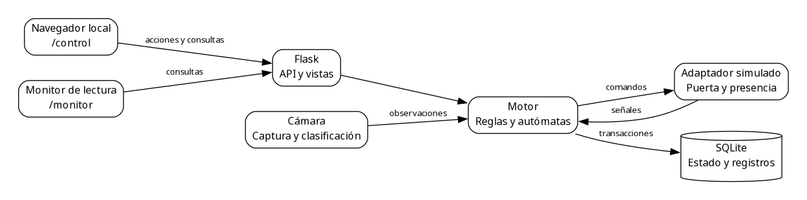
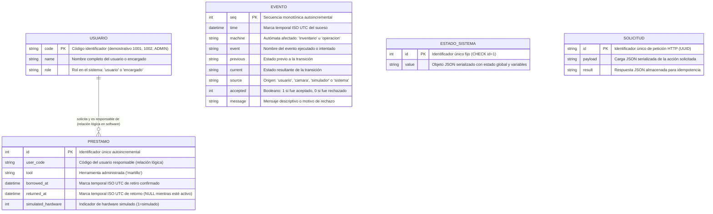
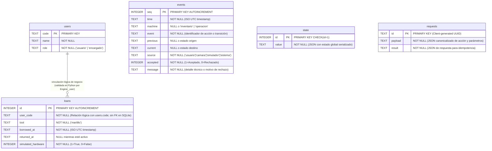

# Avance 5 — VIII. Diseño de la solución

> **Documento de sustentación técnica y de ingeniería.**  
> Este documento expone el diseño integral del **Sistema de préstamo de herramientas basado en autómatas finitos y verificación visual**, organizado en los cuatro componentes fundamentales establecidos por la guía académica ([guía Avance 5](https://avance5proyectoaula.netlify.app/)): **A. Arquitectura del sistema**, **B. Diseño funcional**, **C. Diseño de datos** y **D. Diseño de interfaces**.  
> El diseño responde a los requerimientos del [Avance 4](AVANCE4_ANALISIS.md), describe la implementación del repositorio (`app/`, `simulator/`, `templates/`) y sustenta las decisiones de ingeniería adoptadas.

---

## A. Arquitectura del sistema

### A.1 Estructura general de la solución en capas
La solución adopta una arquitectura desacoplada por capas con una **única autoridad de estado centralizada**, ejecutándose en un entorno de red de área local (LAN) o estación de trabajo independiente. El diseño separa limpiamente la interfaz de usuario, la exposición de servicios web, la lógica de control formal, el subsistema de visión por computadora, la adaptación de sensores y la persistencia atómica.



**Figura A1. Arquitectura del prototipo visual.** El servidor recibe acciones locales y consultas del monitor. El motor valida reglas y guarda registros; la cámara aporta observaciones y el adaptador representa puerta y presencia simuladas. El simulador del puerto 8001 es independiente y mantiene estado en memoria.


### A.2 Distinción fundamental de los tres entornos del proyecto
Para evitar confusiones conceptuales durante la sustentación académica, el diseño delimita expresamente tres componentes técnicos diferenciados:

1. **Prototipo principal con cámara y hardware simulado (Puerto 8000):**  
   Es el prototipo principal (`app/`, `run.py`). Ejecuta el motor determinista con persistencia en `data/prestamos.sqlite`, soporta la captura de video en vivo mediante cámara web o DroidCam, evalúa la ventana temporal de evidencia visual mediante `CameraManager`, aplica el token de seguridad para el Centro de Control local y sirve la vista sincronizada de monitoreo.
2. **Simulador didáctico independiente (Puerto 8001):**  
   Es un entorno puramente educativo (`simulator/`, `run_simulador.py`) desarrollado para permitir la experimentación interactiva de los autómatas sin requerir una cámara conectada, sin cargar modelos neuronales y sin alterar la base de datos de préstamos. Administra su estado exclusivamente en memoria RAM y cuenta con controles 3D y guiones pregrabados de demostración.
3. **Hardware simulado (`SimulatedHardware`) vs. Circuito electromecánico:**  
   En la fase actual del prototipo, las señales físicas de apertura/cierre de la compuerta y el sensor de presencia simulado se gestionan mediante el adaptador `SimulatedHardware` (`app/hardware.py`). Una orden de apertura emitida por el motor solicita la acción al adaptador, pero la transición a puerta abierta no ocurre hasta que el sensor simulado emite el evento de conmutación. Esto replica la arquitectura desacoplada prevista para una futura integración física, cuyos componentes y protocolo deben definirse y validarse por separado.

### A.3 Mecanismos de comunicación y seguridad
- **API REST Local:** El cliente web se comunica mediante peticiones asíncronas JSON. La consulta de estado (`GET /api/estado?desde=seq`) utiliza paginación por cursores para recibir únicamente los nuevos eventos ocurridos desde la última revisión.
- **Seguridad en el Centro de Control:** Las operaciones de mutación (`POST /api/acciones`) exigen que la petición provenga de una dirección IP de bucle invertido (*loopback* `127.0.0.1` o `::1`), que coincida la cabecera `Origin` y que incluya el token criptográfico `X-Control-Token` generado de forma aleatoria con 32 bytes (`secrets.token_urlsafe(32)`) y validado mediante comparación de tiempo constante (`hmac.compare_digest`).
- **Aislamiento del Monitor (`/monitor`):** La vista para tabletas y observadores no recibe el token de control. Si un usuario intenta enviar una petición `POST` desde un dispositivo remoto en la red local, el servidor rechaza la solicitud con código HTTP 403 Forbidden.
- **Idempotencia de peticiones:** Cada acción enviada desde la interfaz contiene un identificador único de petición (`id`). Si una petición se retransmite por inestabilidad de la red, el motor localiza el identificador en la tabla `requests` y entrega el resultado previo almacenado sin reejecutar la lógica ni duplicar registros.

### A.4 Diagrama arquitectónico detallado
El diagrama formal en Mermaid se encuentra disponible en [`docs/avances/diagramas/arquitectura.mmd`](avances/diagramas/arquitectura.mmd) y se renderiza a continuación:

```mermaid
flowchart TB
    %% Capa de Clientes
    subgraph Clientes["Capa de Presentación e Interfaz (Navegadores)"]
        ControlPC["Centro de Control Local (PC)<br/>http://127.0.0.1:8000/control<br/>(Lectura/Escritura con X-Control-Token)"]
        MonitorTablet["Monitor de Consulta (Tablet)<br/>http://IP_PC:8000/monitor<br/>(Solo lectura, Polling 500 ms)"]
        SimuladorPC["Simulador Didáctico 3D (PC)<br/>http://127.0.0.1:8001/simulador<br/>(Control independiente en memoria)"]
        SimuladorTablet["Monitor Simulador (Tablet)<br/>http://IP_PC:8001/automatas<br/>(Solo lectura, diagramas sincronizados)"]
    end

    %% Capa de Servidor Web y Seguridad
    subgraph ServidorWeb["Capa de Servicios Web (Python / Flask + Waitress)"]
        subgraph ServidorPrincipal["Módulo Prototipo (Puerto 8000)"]
            FiltroSeguridad["Seguridad y Control de Acceso<br/>- Restricción Loopback para /control<br/>- Comparación del token de X-Control-Token<br/>- Filtro de Origin y Sec-Fetch-Site"]
            APIRest["Endpoints REST Prototipo<br/>- GET /api/estado (snapshot incremental)<br/>- POST /api/acciones (despacho idempotente)<br/>- GET /api/camara/imagen (stream JPEG)<br/>- GET /api/historial.csv (auditoría exportable)"]
        end

        subgraph ServidorSimulador["Módulo Simulador Independiente (Puerto 8001)"]
            APISimulador["Endpoints Simulador<br/>- GET /api/simulador/estado<br/>- POST /api/simulador/acciones"]
            MotorSimulador["Motor de Simulación en Memoria<br/>(Escenarios automáticos y modo paso a paso)"]
        end
    end

    %% Capa de Lógica de Negocio y Control
    subgraph LogicaNegocio["Capa de Lógica de Negocio y Control Central"]
        subgraph MotorPrototipo["Motor Determinista (app.engine.Engine)"]
            Bloqueo["Serialización de Hilos (RLock)"]
            Idempotencia["Gestor de Idempotencia (requests)"]
            Watchdog["Vigilante Temporal (Ticker 250 ms)"]
        end

        subgraph AutomatasyReglas["Modelos Formales (app.automata)"]
            AutInventario["Autómata de Inventario<br/>(5 estados deterministas)"]
            AutOperacion["Autómata de Operación<br/>(8 estados + modos)"]
            ReconocedorAFD["Reconocedor de Trazas AFD"]
        end

        subgraph VisionArtificial["Gestor de Visión (app.camera.CameraManager)"]
            CapturaCV["Captura OpenCV / DroidCam<br/>Buffer circular (deque maxlen 200)"]
            ModeloYOLO["Clasificador YOLO11n-cls<br/>(5 clases: martillo, vacio, etc.)"]
            DatasetMgr["Gestor de Dataset y Sesiones<br/>(Prevención de fuga train/val/test)"]
        end

        subgraph AdaptadorHardware["Adaptador de Hardware (app.hardware)"]
            SimulatedHw["SimulatedHardware (Actual)<br/>- Puerta y presencia simulados<br/>- Sin Arduino electromecánico"]
            ArduinoHw["HardwareAdapter (Contrato Futuro)<br/>- Protocolo Serial Arduino"]
        end
    end

    %% Capa de Persistencia
    subgraph Persistencia["Capa de Persistencia Atómica"]
        SQLiteDB[("SQLite WAL: data/prestamos.sqlite<br/>------------------------------------<br/>- state (estado JSON persistido)<br/>- users (roles demostrativos)<br/>- loans (préstamos y unicidad parcial)<br/>- events (historial secuencial de eventos)<br/>- requests (respuestas idempotentes)")]
        MemoriaSim[("Memoria RAM Volátil<br/>(Estado temporal del simulador)")]
    end

    %% Relaciones y Flujos de Datos
    ControlPC -->|"HTTP POST con Token / GET"| FiltroSeguridad
    MonitorTablet -->|"HTTP GET (sin token)"| APIRest
    SimuladorPC -->|"HTTP POST / GET"| APISimulador
    SimuladorTablet -->|"HTTP GET"| APISimulador

    FiltroSeguridad --> APIRest
    APISimulador --> MotorSimulador
    MotorSimulador --> AutInventario
    MotorSimulador --> AutOperacion
    MotorSimulador --> MemoriaSim

    APIRest --> Bloqueo
    Bloqueo --> Idempotencia
    Idempotencia --> MotorPrototipo
    Watchdog --> MotorPrototipo

    MotorPrototipo --> AutInventario
    MotorPrototipo --> AutOperacion
    MotorPrototipo --> SimulatedHw
    MotorPrototipo --> SQLiteDB

    CapturaCV --> ModeloYOLO
    ModeloYOLO -->|"observe(label, conf, time)"| MotorPrototipo
    DatasetMgr --> CapturaCV
```



---

## B. Diseño funcional

### B.1 Módulos del sistema y responsabilidades

El sistema se estructura en siete módulos funcionales claramente delimitados:

| Módulo Funcional | Componente de Software | Responsabilidad Principal | Requerimientos Asociados |
|---|---|---|---|
| **1. Control de Inventario** | `app/automata.py` (`INVENTORY`), `app/engine.py` | Gestionar el ciclo administrativo del martillo a través de sus 5 estados formales (`Disponible`, `Reservada`, `Prestada`, `En revisión`, `Fuera de servicio`), rechazando cualquier evento no admitido. | RF01, RF02, RF03, RF04, RF05, RF06, RF07; RNF01, RNF02 |
| **2. Control de Operación** | `app/automata.py` (`OPERATION`), `app/engine.py` | Coordinar la secuencia de apertura física, espera de interacción, cierre, verificación sensorial y tratamiento de incidencias en 8 estados operativos. | RF02, RF03, RF04, RF05, RF07, RF10; RNF01, RNF04 |
| **3. Captura y Visión Artificial** | `app/camera.py` (`CameraManager`) | Capturar flujo de video, previsualizar en JPEG, recortar ROI, clasificar imágenes con YOLO11n-cls y gestionar almacenamiento de muestras por sesión sin fuga entre conjuntos. | RF02, RF03, RF04, RF05; RNF06, RNF07 |
| **4. Gestión de Préstamos y Usuarios** | `app/engine.py` (`dispatch`, `_apply`) | Asociar préstamos a códigos de usuario demostrativos, comprobar titularidad en devoluciones y mantener los préstamos en SQLite. El índice único parcial impide dos préstamos activos para la misma herramienta. | RF02, RF03, RF04, RF05, RF08; RNF02, RNF04 |
| **5. Revisión Técnica Humana** | `app/engine.py` (`action in ('aprobar', 'danada', 'reparada')`) | Permitir que el encargado registre su decisión tras revisar la herramienta. La aprobación devuelve el inventario a Disponible; el daño lo deja Fuera de servicio. | RF06 |
| **6. Monitor y Auditoría** | `app/web.py` (`monitor`, `history`), `templates/portal.html` | Exponer la vista de solo lectura `/monitor` para tablets y suministrar la descarga del registro secuencial en formato CSV estructurado. | RF01, RF08, RF09; RNF03, RNF05 |
| **7. Simulación Didáctica Independiente** | `simulator/engine.py`, `simulator/web.py` | Permitir la exploración visual e interactiva de los autómatas con escena 3D y demostraciones automáticas sin alterar los datos del sistema real. | RF01, RF07; RNF01 (Propósito educativo y de sustentación) |

---

### B.2 Modelado formal mediante autómatas finitos deterministas

#### Autómata del ciclo de inventario
El ciclo de vida administrativo de la herramienta se modela como un AFD determinista formal:
$$M_{inv} = (Q_{inv}, \Sigma_{inv}, \delta_{inv}, q_0, F_{inv})$$
- $Q_{inv} = \{\text{Disponible}, \text{Reservada}, \text{Prestada}, \text{En revisión}, \text{Fuera de servicio}\}$
- $q_0 = \text{Disponible}$
- $F_{inv} = \{\text{Disponible}\}$ (único estado donde el ciclo se encuentra cerrado y en descanso)
- $\Sigma_{inv} = \{\text{solicitud\_verificada}, \text{retiro\_verificado}, \text{cancelacion\_verificada}, \text{devolucion\_verificada}, \text{aprobacion}, \text{dano}, \text{reparacion}\}$

Tabla determinista de transiciones $\delta_{inv}$:

| Estado Origen ($q$) | Evento ($\sigma$) | Estado Destino ($\delta(q,\sigma)$) | Condición de Guarda Requerida |
|---|---|---|---|
| `Disponible` | `solicitud_verificada` | `Reservada` | Operación inactiva, puerta cerrada, presencia=True y visión="martillo" estable. |
| `Reservada` | `retiro_verificado` | `Prestada` | Cierre confirmado, presencia=False y visión="vacio" estable post-cierre. |
| `Reservada` | `cancelacion_verificada` | `Disponible` | Cancelación solicitada, puerta cerrada, presencia=True y visión="martillo". |
| `Prestada` | `devolucion_verificada` | `En revisión` | Cierre confirmado, presencia=True y visión="martillo" estable post-cierre. |
| `En revisión` | `aprobacion` | `Disponible` | Código de encargado (`ADMIN`), puerta cerrada, presencia=True y visión="martillo". |
| `En revisión` | `dano` | `Fuera de servicio` | Código de encargado (`ADMIN`) reportando avería o desgaste visible. |
| `Fuera de servicio` | `reparacion` | `En revisión` | Código de encargado (`ADMIN`) certificando finalización de arreglo técnico. |

El diagrama en Mermaid se almacena en [`docs/avances/diagramas/automata_inventario.mmd`](avances/diagramas/automata_inventario.mmd) y se presenta a continuación:

```mermaid
stateDiagram-v2
    [*] --> Disponible: Inicialización

    Disponible --> Reservada: solicitud_verificada<br/>(Código válido + presencia + visión 'martillo')
    
    Reservada --> Prestada: retiro_verificado<br/>(Puerta cerrada + sin presencia + visión 'vacio')
    Reservada --> Disponible: cancelacion_verificada<br/>(Puerta cerrada + presencia + visión 'martillo')
    
    Prestada --> En_revision: devolucion_verificada<br/>(Puerta cerrada + presencia + visión 'martillo')
    
    En_revision --> Disponible: aprobacion<br/>(Inspección humana conforme por Encargado)
    En_revision --> Fuera_de_servicio: dano<br/>(Inspección humana detecta avería o desgaste)
    
    Fuera_de_servicio --> En_revision: reparacion<br/>(Mantenimiento técnico concluido; exige nueva revisión)
```



#### Autómata del control de operación física
Coordina la interacción electromecánica y sensorial en la casilla física:
$$M_{op} = (Q_{op}, \Sigma_{op}, \delta_{op}, \text{Inactiva}, \{\text{Inactiva}\})$$
- $Q_{op} = \{\text{Inactiva}, \text{Abriendo}, \text{Esperando retiro}, \text{Esperando depósito}, \text{Cerrando}, \text{Verificando}, \text{Completada}, \text{Incidencia}\}$
- Modos operativos asociados: $\text{modo} \in \{\text{prestamo}, \text{devolucion}, \text{cancelacion}\}$

El diagrama se almacena en [`docs/avances/diagramas/automata_operacion.mmd`](avances/diagramas/automata_operacion.mmd) y se renderiza a continuación:

```mermaid
stateDiagram-v2
    [*] --> Inactiva: Prototipo encendido

    Inactiva --> Abriendo: iniciar<br/>(Orden 'abrir' emitida)
    
    Abriendo --> Esperando_retiro: abrir_retiro<br/>(Sensor confirma puerta abierta en préstamo)
    Abriendo --> Esperando_deposito: abrir_deposito<br/>(Sensor confirma puerta abierta en devolución)
    
    Esperando_retiro --> Cerrando: solicitar_cierre<br/>(Usuario solicita cierre tras retiro)
    Esperando_deposito --> Cerrando: solicitar_cierre<br/>(Usuario solicita cierre tras depósito)
    
    Cerrando --> Verificando: cierre_confirmado<br/>(Sensor confirma puerta cerrada; activa verify_since)
    
    Verificando --> Completada: verificacion_correcta<br/>(Cámara y presencia confirman contenido esperado)
    
    Completada --> Inactiva: finalizar<br/>(Usuario concluye; libera sesión)
    
    %% Transiciones de error e incidencia
    Abriendo --> Incidencia: fallo (Sensor desconectado / timeout)
    Esperando_retiro --> Incidencia: fallo (Sensor desconectado / discrepancia)
    Esperando_deposito --> Incidencia: fallo (Sensor desconectado / discrepancia)
    Cerrando --> Incidencia: fallo (Avería de cierre)
    Verificando --> Incidencia: fallo (Objeto incorrecto / timeout de verificación)
    
    %% Rutas de recuperación desde incidencia
    Incidencia --> Abriendo: reabrir<br/>(Reintento con puerta cerrada; se vuelve a abrir)
    Incidencia --> Esperando_retiro: recuperar_retiro<br/>(Reintento con puerta abierta en préstamo)
    Incidencia --> Esperando_deposito: recuperar_deposito<br/>(Reintento con puerta abierta en devolución)
```



#### Reconocedor de trazas (AFD Académico en software)
Para la comprobación formal del comportamiento del inventario, la función `recognize(events)` en `app/automata.py` implementa el AFD completo:
$$M_{rec} = (Q_{inv} \cup \{\text{Error}\}, \Sigma_{inv}, \delta_{rec}, \text{Disponible}, \{\text{Disponible}\})$$
Cualquier evento que no coincida con la tabla determinista envía la máquina al estado de sumidero absorbente $\text{Error}$, desde el cual cualquier evento subsiguiente permanece en $\text{Error}$. Esto permite certificar de manera automatizada si una traza histórica ejecutada constituye una secuencia regular válida y terminada.

---

## C. Diseño de datos

### C.1 Modelo conceptual Entidad-Relación (ER)

El modelo conceptual captura las entidades requeridas para sustentar el préstamo controlado, su historial persistente y la persistencia de estados.



El diagrama original se conserva en [`docs/avances/diagramas/modelo_er.mmd`](avances/diagramas/modelo_er.mmd).

---

### C.2 Modelo relacional físico y esquema SQLite

El prototipo utiliza SQLite como motor relacional empotrado. El esquema físico generado en `app/engine.py` (líneas 41–50) se documenta a continuación con estricta fidelidad técnica:

```sql
PRAGMA journal_mode=WAL;

CREATE TABLE IF NOT EXISTS state (
    id INTEGER PRIMARY KEY CHECK(id=1), 
    value TEXT NOT NULL
);

CREATE TABLE IF NOT EXISTS users (
    code TEXT PRIMARY KEY, 
    name TEXT NOT NULL, 
    role TEXT NOT NULL
);

CREATE TABLE IF NOT EXISTS loans (
    id INTEGER PRIMARY KEY AUTOINCREMENT, 
    user_code TEXT NOT NULL,
    tool TEXT NOT NULL, 
    borrowed_at TEXT NOT NULL, 
    returned_at TEXT, 
    simulated_hardware INTEGER NOT NULL
);

CREATE UNIQUE INDEX IF NOT EXISTS one_active_loan 
ON loans(tool) WHERE returned_at IS NULL;

CREATE TABLE IF NOT EXISTS events (
    seq INTEGER PRIMARY KEY AUTOINCREMENT, 
    time TEXT NOT NULL,
    machine TEXT, 
    event TEXT NOT NULL, 
    previous TEXT, 
    current TEXT, 
    source TEXT NOT NULL,
    accepted INTEGER NOT NULL, 
    message TEXT NOT NULL
);

CREATE TABLE IF NOT EXISTS requests (
    id TEXT PRIMARY KEY, 
    payload TEXT NOT NULL, 
    result TEXT NOT NULL
);
```

#### Diccionario de datos y especificación de tablas

| Tabla | Columna | Tipo SQLite | Restricción | Propósito y regla de negocio |
|---|---|---|---|---|
| `state` | `id` | `INTEGER` | `PRIMARY KEY CHECK(id=1)` | Permite como máximo una fila, con identificador 1. La aplicación crea o recupera esa fila al iniciar. |
| `state` | `value` | `TEXT` | `NOT NULL` | Objeto JSON estructurado con el estado de ambos autómatas, variables de compuerta, presencia y mensajes. |
| `users` | `code` | `TEXT` | `PRIMARY KEY` | Código alfanumérico identificador (`1001`, `1002`, `ADMIN`). |
| `users` | `name` | `TEXT` | `NOT NULL` | Nombre descriptivo del actor. |
| `users` | `role` | `TEXT` | `NOT NULL` | Rol de seguridad: `'usuario'` para estudiantes o `'encargado'` para el administrador. |
| `loans` | `id` | `INTEGER` | `PRIMARY KEY AUTOINCREMENT` | Identificador autoincremental de préstamo. |
| `loans` | `user_code` | `TEXT` | `NOT NULL` | Código del usuario responsable. **Relación lógica** con `users.code` (ver aclaración abajo). |
| `loans` | `tool` | `TEXT` | `NOT NULL` | Herramienta prestada (`'martillo'`). |
| `loans` | `borrowed_at` | `TEXT` | `NOT NULL` | Marca temporal ISO 8601 UTC en milisegundos (`utc()`) en que se verificó el retiro. |
| `loans` | `returned_at` | `TEXT` | `NULL` | Marca temporal ISO UTC de devolución verificada. Si es `NULL`, el préstamo permanece **activo**. |
| `loans` | `simulated_hardware` | `INTEGER` | `NOT NULL` | Entero booleano (1 si se utilizó hardware simulado, 0 para hardware real). |
| `events` | `seq` | `INTEGER` | `PRIMARY KEY AUTOINCREMENT` | Número secuencial estrictamente creciente para paginación incremental de auditoría. |
| `events` | `time` | `TEXT` | `NOT NULL` | Marca temporal ISO UTC del suceso. |
| `events` | `machine` | `TEXT` | `NULL` | Nombre del autómata afectado (`'inventario'`, `'operacion'` o `NULL` si es general). |
| `events` | `event` | `TEXT` | `NOT NULL` | Identificador del evento ejecutado o intentado. |
| `events` | `previous` | `TEXT` | `NULL` | Estado previo a la transición. |
| `events` | `current` | `TEXT` | `NULL` | Estado alcanzado tras la transición. |
| `events` | `source` | `TEXT` | `NOT NULL` | Origen: `'usuario'`, `'camara'`, `'simulador'` o `'sistema'`. |
| `events` | `accepted` | `INTEGER` | `NOT NULL` | 1 si la transición fue aceptada; 0 si la acción fue rechazada. |
| `events` | `message` | `TEXT` | `NOT NULL` | Explicación textual del cambio o justificación del rechazo. |
| `requests` | `id` | `TEXT` | `PRIMARY KEY` | Identificador UUID enviado por el cliente para control de idempotencia. |
| `requests` | `payload` | `TEXT` | `NOT NULL` | Carga JSON canónica de la petición. |
| `requests` | `result` | `TEXT` | `NOT NULL` | Respuesta JSON almacenada para reenvío directo en peticiones repetidas. |

> [!IMPORTANT]
> **Fidelidad técnica: Llaves Primarias y Relaciones Lógicas sin invención de FK:**  
> En el esquema DDL real de SQLite, la columna `loans.user_code` **no cuenta con una cláusula formal de clave foránea** (`FOREIGN KEY ... REFERENCES users(code)`). La integridad referencial entre préstamos y usuarios se valida de forma imperativa en la lógica de negocio de Python a través del método `Engine._user(code)` (`app/engine.py`, línea 98), el cual comprueba la existencia del registro en `users` antes de autorizar cualquier préstamo. En estricto apego a la honestidad técnica, este vínculo se modela como una **relación lógica de dominio**, sin falsificar restricciones sintácticas que no existen en el código SQLite real.

#### Diagrama relacional físico
El diagrama relacional se conserva en [`docs/avances/diagramas/modelo_relacional.mmd`](avances/diagramas/modelo_relacional.mmd) y se renderiza a continuación:



---

## D. Diseño de interfaces

El diseño de interfaces provee vistas diferenciadas para la operación autorizada en la estación local, la supervisión de solo lectura en pantallas remotas y la simulación didáctica.

### Fig. 1. Centro de control local (`templates/portal.html` con `mode="control"`)

Pantalla principal diseñada para el computador de la estación de trabajo local (`http://127.0.0.1:8000/control`). Permite al operador y a los usuarios interactuar con el flujo del prototipo bajo autorización estricta:
- **Selector de usuario demostrativo:** Permite elegir entre los códigos `1001`, `1002` o `ADMIN`.
- **Panel de acciones operativas:** Despliega dinámicamente los botones habilitados según el estado de la máquina: «Solicitar martillo», «Cerrar», «Finalizar», «Iniciar devolución» o «Cancelar». Los botones no aplicables se deshabilitan para evitar confusiones.
- **Sección de revisión técnica del encargado:** Muestra los botones de supervisión humana («Aprobar», «Registrar daño», «Reparada»), protegidos por validación del rol `encargado`.
- **Monitor de visión y hardware:** Exhibe el cuadro de previsualización JPEG de la cámara con el recuadro de la región de interés (ROI), el estado de conexión del dispositivo, la clase predicha con su confianza porcentual, y los interruptores para conmutar las señales de hardware simulado (puerta y sensor de presencia).
- **Indicador luminoso virtual (LED):** Semáforo visual que refleja el estado de la operación: verde (en proceso), rojo fijo (prestada/no disponible), rojo intermitente (incidencia) o apagado (disponible).

  
*Fig. 1. Prototipo del Centro de Control local en interfaz de escritorio (`mode="control"`), mostrando botones de acción, estado de sensores simulados y visor de cámara.*

---

### Fig. 2. Monitor de visualización de autómatas (`templates/portal.html` con `mode="monitor"`)

Vista de solo lectura orientada a una segunda pantalla, tableta de supervisión o proyector de exposición (`http://IP_DEL_COMPUTADOR:8000/monitor`).
- **Diagramas de estados SVG interactivos:** Presenta los dos autómatas en pantalla completa (lado a lado en orientación horizontal o apilados en orientación vertical). Los nodos correspondientes al estado corriente se resaltan con iluminación activa y las transiciones ejecutadas animan su recorrido.
- **Transparencia operativa y seguridad:** La vista se actualiza automáticamente cada 500 ms mediante consultas incrementales a `/api/estado`. No incluye ningún formulario, botón de control ni el token criptográfico de escritura.
- **Panel de telemetría y conexión:** Muestra el indicador de sincronización en tiempo real, la hora de la última sincronización, el último mensaje descriptivo del motor y la indicación explícita de hardware simulado.

  
*Fig. 2. Monitor de supervisión en tiempo real para tableta (`mode="monitor"`), mostrando los autómatas de inventario y operación coordinados y el mensaje de estado del sistema.*

---

### Fig. 3. Simulador didáctico 3D interactivo (`templates/simulation.html`)

Módulo complementario e independiente para la sustentación pedagógica y experimentación de contingencias (`http://127.0.0.1:8001/simulador`):
- **Compartimiento 3D virtual:** Renderizado en perspectiva con controles orbitales de giro, mostrando la herramienta en el interior, la apertura/cierre animada de la compuerta y la presencia de objetos.
- **Modos de ejecución dual:** Permite avanzar paso a paso manualmente o reproducir de manera automática cualquiera de los cinco escenarios didácticos preconfigurados:
  1. *Ciclo completo:* Reserva, retiro, devolución y aprobación exitosas.
  2. *Objeto incorrecto:* Intento de cierre depositando un alicate, rechazo inmediato por discrepancia visual y corrección posterior con martillo.
  3. *Fallo y recuperación:* Desconexión forzada del sensor durante la verificación, entrada en estado `Incidencia` y procedimiento de reintento.
  4. *Daño y reparación:* Flujo completo de inspección humana: `En revisión` → `Fuera de servicio` → `En revisión` → `Disponible`.
  5. *Cancelar reserva:* Cancelación del retiro con el martillo en la casilla, liberando la herramienta a `Disponible` sin crear préstamo.
- **Autonomía total:** No interactúa con la base de datos `prestamos.sqlite` ni requiere cámara web, permitiendo demostrar la lógica sin depender de la iluminación de una cámara.

---

## Correspondencia y trazabilidad con el Avance 4

La tabla siguiente relaciona componentes del diseño con requisitos definidos en la [Fase de Análisis](AVANCE4_ANALISIS.md):

| Elemento de Análisis (Avance 4) | Concreción en el Diseño (Avance 5) | Justificación de Coherencia |
|---|---|---|
| **Actor: Usuario / Estudiante** | Centro de control (`portal.html`), roles en `users`, métodos `solicitar`, `devolver`, `cerrar`. | Permite al estudiante retirar y devolver con validación previa y posterior. |
| **Actor: Encargado de Laboratorio** | Sección de revisión técnica en panel de control, acciones `aprobar`, `danada`, `reparada`. | Permite comprobar que ninguna herramienta reingrese al inventario sin inspección humana. |
| **Actor: Visión y Sensores** | `CameraManager` con YOLO11n-cls y `SimulatedHardware`. | Convierte observaciones físicas y ópticas en entradas discretas para el motor. |
| **RF01 (Visualización de estados)** | Endpoint `/api/estado`, monitor `/monitor` y diagramas SVG interactivos. | Presenta ambos autómatas con refresco de 500 ms y telemetría de conexión. |
| **RF02, RF03 (Préstamo verificado)** | Acciones `solicitar`, `abrir_retiro`, `cerrar`, verificación visual post-cierre e inserción en tabla `loans`. | Bloquea el registro de retiros que no cumplan las reglas y exige que el préstamo solo se cree tras verificar casilla vacía. |
| **RF04, RF05 (Devolución y revisión)** | Acción `devolver`, validación de responsable en `loans`, verificación post-cierre de martillo y transición a `En revisión`. | Cierra el registro del préstamo pero bloquea la disponibilidad hasta la aprobación del encargado. |
| **RF06 (Inspección técnica)** | Métodos `_apply` para `aprobar`, `danada`, `reparada` con verificación `admin=True`. | Soporta el tratamiento de herramientas deterioradas y su retorno seguro. |
| **RF07 (Rechazo determinista)** | Excepción `Rejected`, reversión de estado (`deepcopy`) y registro en `events` con `accepted = 0`. | Mantiene la integridad formal del autómata ante secuencias o datos inválidos. |
| **RF08 (Historial persistente)** | Tabla relacional `events` y descarga CSV vía `/api/historial.csv`. | Proporciona trazabilidad completa para auditoría académica y técnica. |
| **RNF02 (Unicidad de préstamos)** | Índice único parcial `one_active_loan` en tabla `loans`. | Impide dos préstamos simultáneos del mismo martillo a nivel de motor de datos. |
| **RNF03 (Seguridad local)** | Filtro loopback en Flask, cabeceras `Origin`/`Sec-Fetch-Site` y token aleatorio `X-Control-Token`. | Protege las funciones de control de operaciones frente a peticiones indebidas de la red. |

---

## Límites técnicos, evidencia actual y verificaciones pendientes

### 1. Estado de verificación de software
- **Suite de pruebas automatizadas:** Al 5 de noviembre de 2026, la suite completa de pruebas consta de **47 pruebas automatizadas aprobadas en 0,62 segundos** (`.venv/bin/python -m pytest -q`).
- **Naturaleza de la evidencia:** Estas pruebas corresponden a **observaciones controladas en memoria**, fixtures simulados y escenarios sintéticos que comprueban la lógica de los autómatas, la persistencia en SQLite, el aislamiento de permisos y la sincronización. **No constituyen una medición de precisión en condiciones físicas reales de laboratorio**.

### 2. Dispositivos físicos y hardware simulado
- Las compuertas y sensores de presencia simulados están gobernados por software (`SimulatedHardware`). No existe un circuito Arduino ni actuador electromecánico instalado en la casilla en esta etapa. Por ello, las devoluciones se registran formalmente como *verificación visual con hardware simulado*, sin certificar la existencia de una cerradura electromecánica física.

### 3. Modelo de visión artificial y dataset propio
- Al momento de esta documentación, la carpeta `dataset/` no contiene imágenes recolectadas y el archivo `models/herramientas.pt` está ausente en el repositorio.
- El prototipo cuenta con la infraestructura completa para captura guiada (`CameraManager.capture`) con control de sesiones (`sessions.json`) para prevenir fuga de datos entre `train`, `val` y `test`, y con scripts de entrenamiento (`tools/train_model.py`) y evaluación (`tools/evaluate_model.py`).
- **Pendiente indispensable para la demostración con cámara:**
  1. Conectar cámara web o celular mediante DroidCam y fijar iluminación y encuadre.
  2. Capturar muestras fotográficas para las cinco clases (`martillo`, `destornillador`, `alicate`, `vacio`, `otros`).
  3. Ejecutar el entrenamiento del clasificador YOLO11n-cls.
  4. Generar la matriz de confusión y medir exactitud y tasa de falsos positivos en el conjunto de prueba independiente.
  5. Ejecutar los diez ciclos de validación con cámara real documentando los tiempos reales.
  No se asignan cifras de precisión o exactitud hasta que el equipo realice estas mediciones en hardware real.

---

## Uso ético y responsable de la inteligencia artificial

Conforme a las disposiciones académicas del curso y las directrices de la [guía del Avance 5](https://avance5proyectoaula.netlify.app/):
- La inteligencia artificial se empleó exclusivamente como asistente técnico en la estructuración de la arquitectura, redacción de especificaciones de ingeniería y diseño de sintaxis de diagramas Mermaid.
- Cada componente, tabla relacional, autómata y flujo fue confrontado con el código fuente del proyecto (`app/engine.py`, `app/automata.py`, `app/web.py`, `app/camera.py`, `simulator/engine.py`), corrigiendo cualquier desviación previa (como la denominación del modo de vista en `web.py`, que es `mode="monitor"` y no `tablet`).
- Se respetó la fidelidad estricta del esquema SQLite, documentando la relación lógica entre préstamos y usuarios sin inventar restricciones foráneas no implementadas.
- No se introdujeron datos privados, sensibles ni de terceros.
- El equipo estudiantil debe revisar y comprender el diseño y validar su correspondencia con el contexto antes de la sustentación. Esta redacción no acredita una revisión humana ya realizada.

## Figuras y alcance de las evidencias de interfaz

Las capturas incluidas proceden de las pruebas históricas de interfaz descritas en `docs/VALIDACION.md`; no muestran entrenamiento de un modelo propio ni una prueba de custodia física. La [galería de figuras](avances/FIGURAS.md) contiene versiones PNG, SVG y fuentes DOT editables de arquitectura, autómatas y datos. El modelo conceptual describe entidades del dominio; el modelo relacional utiliza los tipos TEXT e INTEGER del esquema SQLite real.
