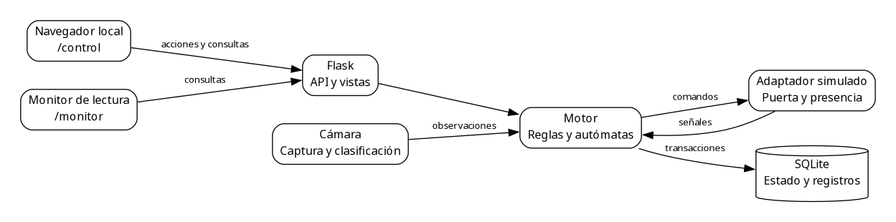
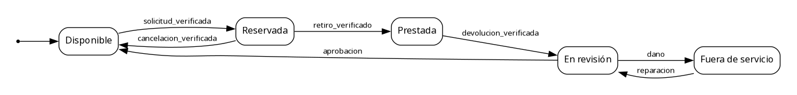
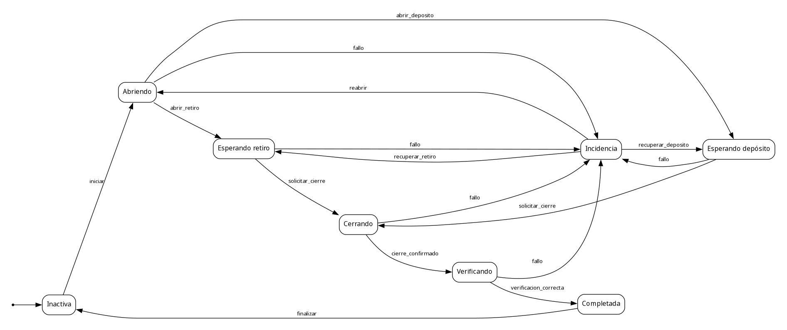
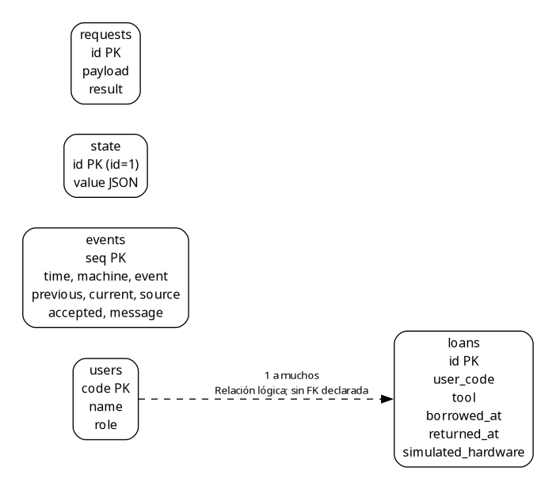

# Figuras técnicas exportables

Figuras de apoyo para el Word y el PowerPoint. Usar SVG para conservar nitidez o PNG cuando la plantilla no admita SVG. Los archivos DOT son editables y se regeneran mediante `python tools/build_avances_figuras.py` con Graphviz instalado. Los autómatas se construyen directamente desde `app/automata.py`.

## Figura 1 Arquitectura del módulo visual

La interfaz local y el monitor consultan Flask; el motor concentra las reglas y la persistencia. La cámara aporta observaciones y el adaptador representa señales de puerta y presencia simuladas. Las flechas indican dependencias o intercambios principales, no cada respuesta HTTP. El simulador didáctico constituye una aplicación independiente, descrita en el Avance 5.

[SVG](figuras/arquitectura.svg) · [Fuente DOT](figuras/arquitectura.dot)

## Figura 2 Autómata de inventario

Incluye las siete transiciones de inventario implementadas. El punto señala el estado inicial. Es el controlador del inventario; el reconocedor académico añade Error y la condición de aceptación Disponible. El daño lo determina una persona encargada.

[SVG](figuras/automata_inventario.svg) · [Fuente DOT](figuras/automata_inventario.dot)

## Figura 3 Autómata de operación

Representa los ocho estados y las transiciones de apertura, espera, cierre, verificación, finalización y recuperación. Para exponerlo conviene usar una diapositiva completa y recorrer primero la ruta nominal; después explicar las aristas de fallo.

[SVG](figuras/automata_operacion.svg) · [Fuente DOT](figuras/automata_operacion.dot)

## Figura 4 Tablas y relación lógica

El vínculo punteado entre users y loans es lógico; no existe una restricción SQL FOREIGN KEY declarada. Las otras tablas no tienen FK declaradas entre sí. El índice único parcial de loans impide múltiples préstamos activos de la misma herramienta. `state.value` almacena JSON en una columna TEXT de SQLite.

[SVG](figuras/modelo_datos.svg) · [Fuente DOT](figuras/modelo_datos.dot)

## Figura 5 Centro de control

Captura histórica de la interfaz: código de demostración, acciones, cámara, compartimiento simulado y diagramas. No es evidencia de entrenamiento del modelo ni de funcionamiento del mecanismo físico. Su procedencia y límites están en `docs/VALIDACION.md`.

## Figura 6 Monitor

Vista de lectura para observar estados e historial. La captura corresponde a las pruebas documentadas de interfaz, no a una medición nueva sobre la red y tablet de la exposición.
